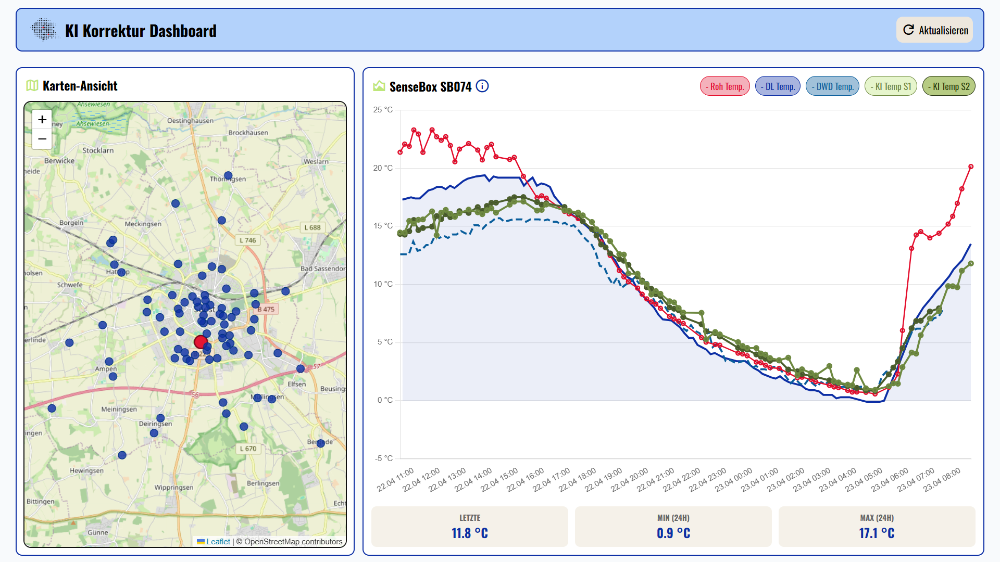

# Urban Climate Twin Soest – KI Korrektur Dashboard



Dashboard zur Visualisierung von Temperaturdaten städtischer Sensoren (senseBox) mit KI-korrigierten Messwerten.

---
## Urban Climate Twin Soest

 [Urban Climate Twin (UCT) Soest](https://www.fh-swf.de/de/forschung___transfer_4/forschungsprojekte_1/forschungsprojekt_uct.php) ist ein digitaler Zwilling des Soester Stadtklimas. Er führt Messdaten, Geodaten und weitere Klimadaten zusammen und macht das Stadklima räumlich nachvollziehbar. Bürger und die Stadtverwaltung können so die Auswirkungen von Klimaveränderungen auf das Stadtgebiet besser verstehen und Maßnahmen zur Anpassung an den Klimawandel entwickeln.

---

## Features

- Kartenansicht aller aktiven Sensoren (Leaflet + OpenStreetMap)
- Zeitreihendiagramm mit Roh-, KI-korrigierten (Stage 1 & 2), Nachbar- und DWD-Referenztemperaturen
- Zoom und Pan im Diagramm, ältere Daten werden beim Scrollen nachgeladen
- Statistikzeile: aktueller, minimaler und maximaler Wert der letzten 24h
- Verlinkbarer Zustand über URL-Parameter (`?sensor=<id>`)
- Automatischer Refresh alle 10 Minuten

---

## Projektstruktur

```bash
/
├── public/
│   └── src/
│       ├── chart.config.js   # Chart.js Dataset- und Options-Konfiguration
│       ├── chart.js          # Chart-Logik, Backfill, Stats
│       ├── map.js            # Leaflet-Karte, Sensor-Layer
│       ├── main.js           # Datenladen, Refresh, URL-Handling
│       └── style.css
├── server.js                 # Express-Server, API-Endpunkte, DB-Verbindung
├── Dockerfile
├── docker-compose.yml
└── nginx.conf                # Reverse Proxy mit TLS
```

---

## Deployment

### Voraussetzungen auf dem Host

- Docker mit Compose Plugin
- SSL-Zertifikat und privater Schlüssel (`fullchain.pem` / `privkey.pem`)
  - z.B. per [Let's Encrypt / Certbot](https://certbot.eff.org/) oder selbstsigniert (s.u.)

### Umgebungsvariablen

`.env`-Datei im Projektroot anlegen (Vorlage: `.env.example`):

| Variable | Pflicht | Default | Beschreibung |
| --- | --- | --- | --- |
| `PORT` | | `3000` | Port für den Express-Server |
| `DB_HOST` | ✅ | – | Hostname der PostgreSQL-Instanz |
| `DB_PORT` | | `5432` | Port der PostgreSQL-Instanz |
| `DB_NAME` | ✅ | – | Datenbankname |
| `DB_USER` | ✅ | – | Datenbanknutzer |
| `DB_PASSWORD` | ✅ | – | Passwort des Datenbanknutzers |
| `DWD_ID` | | `DWD001` | ID der Referenzwetterstation für DWD-Temperaturen |
| `SSL_KEYS_PATH` | ✅ | – | Absoluter Pfad zum Verzeichnis mit `fullchain.pem` und `privkey.pem` |
| `API_TIMEOUT_MS` | | `30000` | Timeout für DB-Anfragen in ms |
| `RATE_LIMIT_WINDOW_MS` | | `60000` | Zeitfenster für API-Rate-Limit (ms) |
| `RATE_LIMIT_MAX` | | `60` | Max. Requests pro IP pro Zeitfenster |
| `RATE_LIMIT_STRICT_WINDOW_MS` | | `10000` | Zeitfenster für strenge Endpunkte (ms) |
| `RATE_LIMIT_STRICT_MAX` | | `10` | Max. Requests pro IP für strenge Endpunkte |

## API

| Endpunkt | Beschreibung |
| --- | --- |
| `GET /api/sensors` | Alle aktiven senseBox-Sensoren als GeoJSON |
| `GET /api/sensor/:id/measurements` | Messdaten der letzten 24h |
| `GET /api/sensor/:id/neighbors` | Nachbarsensoren im Gültigkeitsbereich |
| `GET /api/sensor/dwd` | DWD-Referenztemperaturen für denselben Zeitraum (liefert immer Daten der Referenzwetterstation) |
| `GET /health` | Health-Check des Servers |

### Parameter

| Parameter | Beschreibung |
| --- | --- |
| `?end` | End-Datum für die Datenauswahl (z.B. `?end=2023-10-01T00:00:00Z`) |
| `?date` | Datum für die Datenauswahl (z.B. `?date=2023-10-01`) |

### SSL-Zertifikate

Der Container erwartet im Verzeichnis `SSL_KEYS_PATH` zwei Dateien:

```bash
<SSL_KEYS_PATH>/
├── fullchain.pem # Zertifikat (inkl. Zwischenzertifikate)
└── privkey.pem # Privater Schlüssel
```

**Let's Encrypt:**

```bash
certbot certonly --standalone -d <domain>
# Zertifikate liegen danach in /etc/letsencrypt/live/<domain>/
SSL_KEYS_PATH=/etc/letsencrypt/live/<domain>
```

Selbstsigniert:

```bash
mkdir -p ./ssl
openssl req -x509 -newkey rsa:4096 -keyout ./ssl/privkey.pem \
  -out ./ssl/fullchain.pem -days 365 -nodes \
  -subj "/CN=localhost"
SSL_KEYS_PATH=$(pwd)/ssl
```

## Lizenz

Copyright 2026 Urban Climate Twin Fachhochschule Südwestfalen

Lizenziert unter der [Apache License 2.0](LICENSE).